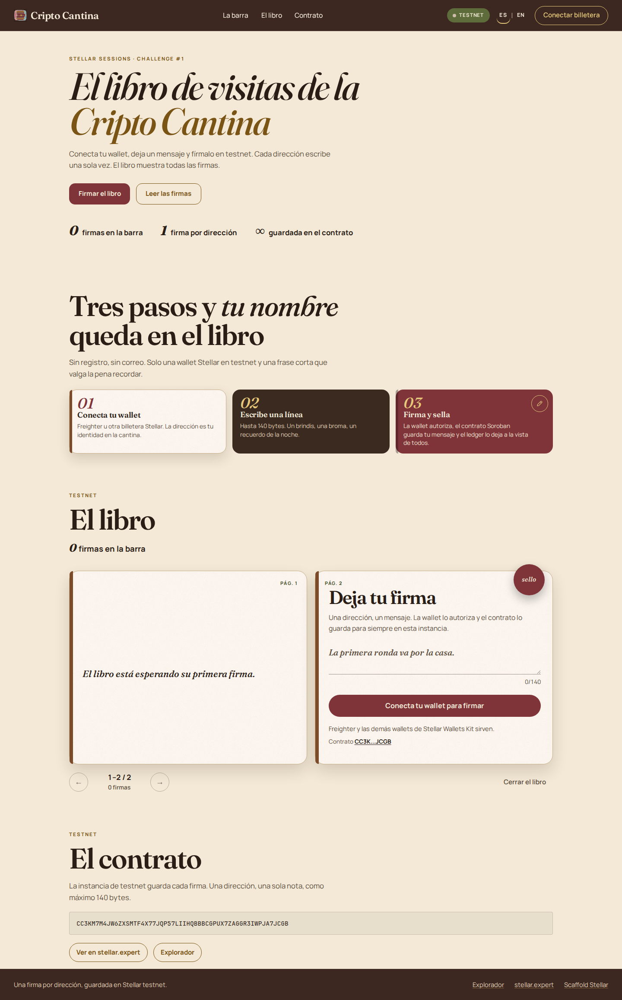

# El libro de visitas de la Cripto Cantina

Una dApp de Stellar Sessions, challenge #1. Quien quiera pasa por la barra,
conecta su wallet y deja un mensaje firmado en Soroban. La página muestra todas
las firmas.

**En vivo:** https://julissb51-cell.github.io/cripto-cantina-guestbook/

Esa página habla con el contrato de testnet que ya está desplegado. No hace
falta clonar el repo para dejar una firma.

El proyecto salió de Scaffold Stellar (`stellar scaffold init --template react`)
y el contrato es propio.

## Contrato en testnet

**ID:** `CC3KM7M4JW6ZXSMTF4X77JQP57LIIHQBBBCGPUX7ZAGGR3IWPJA7JCGB`

**Explorador:**
https://stellar.expert/explorer/testnet/contract/CC3KM7M4JW6ZXSMTF4X77JQP57LIIHQBBBCGPUX7ZAGGR3IWPJA7JCGB

Es una instancia nueva, sin firmas de prueba. La publicó la identidad
`cripto-cantina-deployer`
(`GBIUQ2QDPHKHRNEZPNIMQSR4HVQUX4HXTUQ4TDCQVVRSVOGG5RSYTXZ4`); Friendbot la
fondeó. La clave secreta no está en el repositorio.

`scaffold.yml` apunta la red `testnet` a ese ID, así que el cliente generado no
publica otra instancia.

La instancia anterior de prueba era
`CDYLDNBCQJZZALN4QJRV5YN5MSWOSK6UCLWPA4JY22S3CCDFWNG3VU4K`.

## Cómo correrlo

Hace falta Rust (el `rust-toolchain.toml` pide 1.93 y el target
`wasm32v1-none`), Node.js 22, la Stellar CLI y Scaffold Stellar:

```bash
cargo install --locked stellar-cli
cargo install --locked stellar-scaffold-cli
```

Con los binarios ya instalados:

```bash
npm install
cp app/.env.example app/.env
npm start
```

`app/.env` deja `STELLAR_NETWORK=testnet`. `npm start` corre
`stellar scaffold watch --build-clients`, que regenera el cliente del contrato
ya desplegado, y abre la app en http://localhost:43117.

En esta versión de la CLI hace falta `--build-clients` para generar el cliente y
publicar. Sin esa bandera, `build` y `watch` solo compilan el Wasm.

Para compilar el frontend sin el modo watch:

```bash
npm run build --workspace app
```

Esa build usa el cliente de testnet ya incluido en `app-lib/clients` (y
`app/.env.production`). No levanta una red local ni publica el contrato. El
resultado queda en `app/dist`, con la base `/cripto-cantina-guestbook/` para
GitHub Pages.

Los tests del contrato:

```bash
cargo test -p libro-de-visitas
```

Cubren firmar, listar (autor, mensaje, ledger y timestamp), `require_auth`, el
rechazo de una segunda firma y el límite de 140 bytes.

## Página en GitHub Pages

https://julissb51-cell.github.io/cripto-cantina-guestbook/

`.github/workflows/pages.yml` construye el frontend en cada push a `main` y lo
publica con GitHub Actions. En el repositorio, Pages tiene que usar el origen
**GitHub Actions** (Settings → Pages → Build and deployment → Source).

## La página



La portada se abre con **Abrir el libro**. Las firmas quedan en las páginas y la
nota nueva se escribe en la última.

En la barra superior, **ES | EN** cambia el idioma de la interfaz. Español es el
idioma por defecto; la elección se guarda en el navegador. Los mensajes ya
firmados en la cadena no se traducen.

Conecta con Freighter u otra wallet del Stellar Wallets Kit, en la red testnet.
Si la cuenta está vacía, **Fondear** le pide XLM a Friendbot. Cada dirección
puede firmar una sola vez: la segunda vez el contrato responde `YaFirmo`.

## El contrato

`contracts/libro-de-visitas`

- `firmar(autor: Address, mensaje: String)` exige `autor.require_auth()`.
- Guarda autor, mensaje, ledger y timestamp, y emite el evento `firma`.
- `listar()` devuelve todas las entradas, de la más antigua a la más reciente.
- Una misma dirección no vuelve a firmar.
- El mensaje no puede ir vacío ni pasar de 140 bytes. Es el recado corto de la
  barra.

Proyecto de Juliana Sanabria para el Challenge #1 de Stellar Sessions
